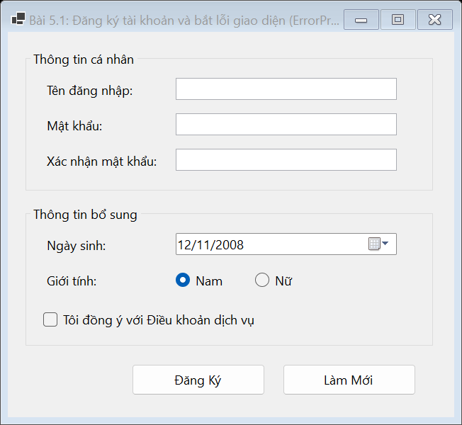
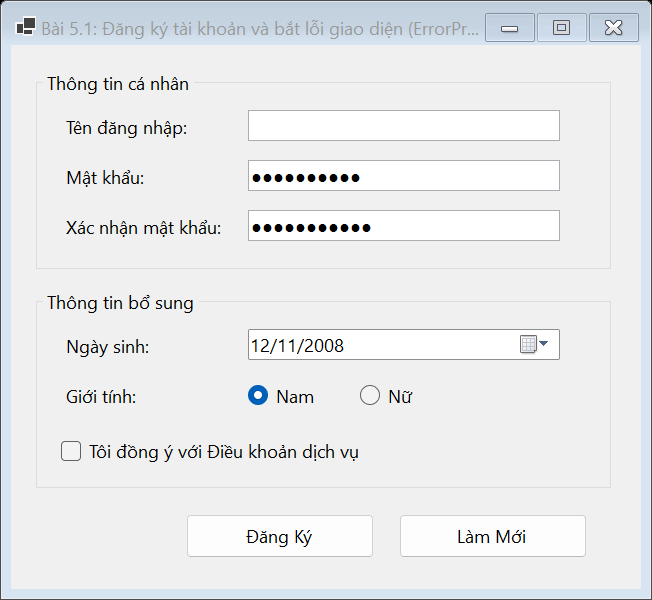
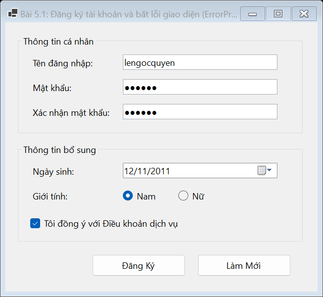
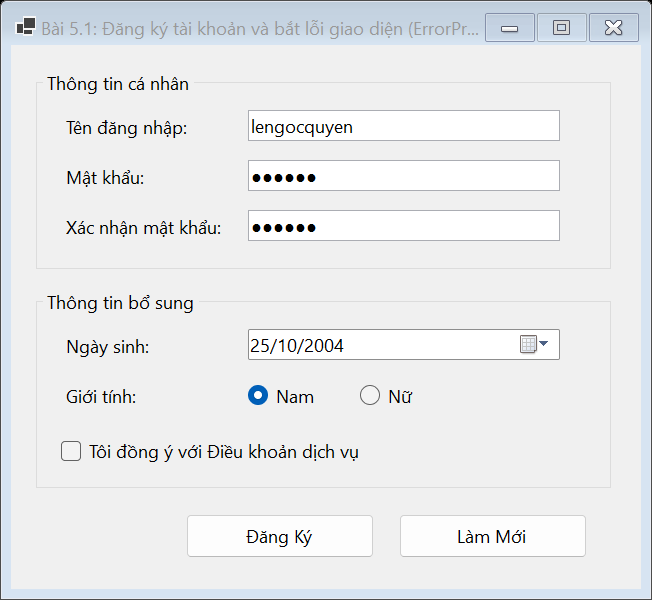
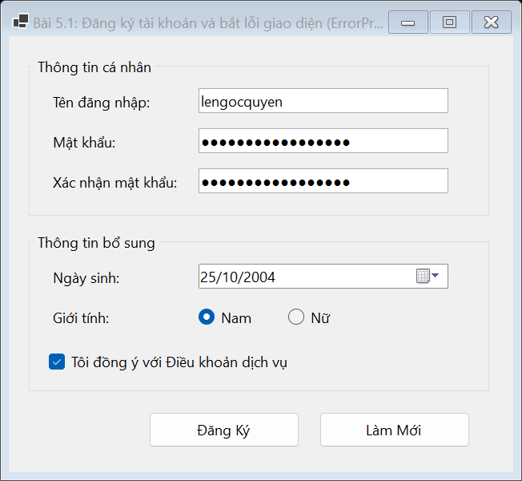

# BÁO CÁO BÀI TẬP / ĐỒ ÁN

## THÔNG TIN SINH VIÊN
- **Họ và tên:** Lê Thị Thúy Hiền
- **Mã số sinh viên:** 24810310243
- **Lớp:** D19CNPM3
- **Tên môn học:** Lập trình C# / Windows Forms
- **Tên bài tập:** BÀI 5.1: Form đăng ký tài khoản và bắt lỗi giao diện (ErrorProvider)

---

## MÔ TẢ TÍNH NĂNG & YÊU CẦU ĐỀ BÀI
1. **Giao diện:**
   - Sử dụng các Control nhập liệu cơ bản: `TextBox`, `DateTimePicker`, `RadioButton`, `CheckBox`.
   - Giữ nguyên giao diện chuẩn native Windows Forms, không màu mè.
   - Nhóm thông tin cá nhân: **Tên đăng nhập**, **Mật khẩu**, **Xác nhận mật khẩu** (`UseSystemPasswordChar = true`).
   - Nhóm thông tin bổ sung: **Ngày sinh** (`DateTimePicker`), **Giới tính** (`RadioButton`), **Điều khoản dịch vụ** (`CheckBox`).
   - Sử dụng `ErrorProvider (epCheck)` để hiển thị cảnh báo lỗi trực tiếp cạnh ô nhập liệu.
   - Các nút chức năng: **Đăng Ký** và **Làm Mới**.

2. **Yêu cầu chức năng & Kiểm tra hợp lệ:**
   - Khi nhấn nút **Đăng Ký**, kiểm tra các điều kiện:
     * Tên đăng nhập và Mật khẩu không được để trống.
     * Mật khẩu nhập lại phải khớp với Mật khẩu ban đầu.
     * Độ tuổi tính từ Ngày sinh phải $\ge 18$ tuổi.
     * Phải tích chọn đồng ý Điều khoản dịch vụ.
   - Nếu có ô sai, hiển thị biểu tượng cảnh báo bằng `epCheck` tại đúng ô đó. Nếu tất cả hợp lệ, hiển thị `MessageBox` thông báo thành công.
   - Nút **Làm Mới**: Xóa toàn bộ dữ liệu nhập liệu, reset ngày sinh, xóa lỗi cảnh báo và đưa con trỏ về ô Tên đăng nhập.

---

## KẾT QUẢ KIỂM THỬ THEO YÊU CẦU ĐỀ BÀI

### 1. Giao diện chính ứng dụng

### 2. Kiểm thử Validation: Tên đăng nhập trống & Mật khẩu không khớp
*(ErrorProvider báo lỗi khi để trống Tên đăng nhập hoặc Mật khẩu xác nhận không trùng khớp)*

### 3. Kiểm thử Validation: Độ tuổi tính từ Ngày sinh dưới 18 tuổi
*(ErrorProvider thông báo lỗi khi ngày sinh chọn có tuổi < 18)*

### 4. Kiểm thử Validation: Chưa đồng ý Điều khoản dịch vụ
*(ErrorProvider cảnh báo khi chưa tích chọn Điều khoản dịch vụ)*

### 5. Đăng ký tài khoản hợp lệ thành công
*(Điền đầy đủ thông tin hợp lệ, tuổi $\ge 18$ và đã tích điều khoản dịch vụ)*

