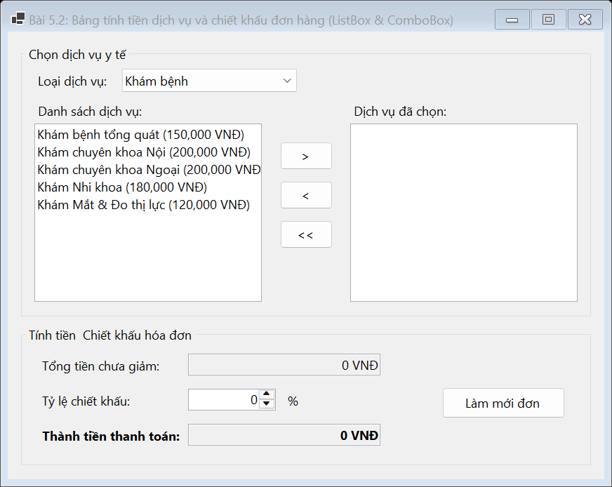
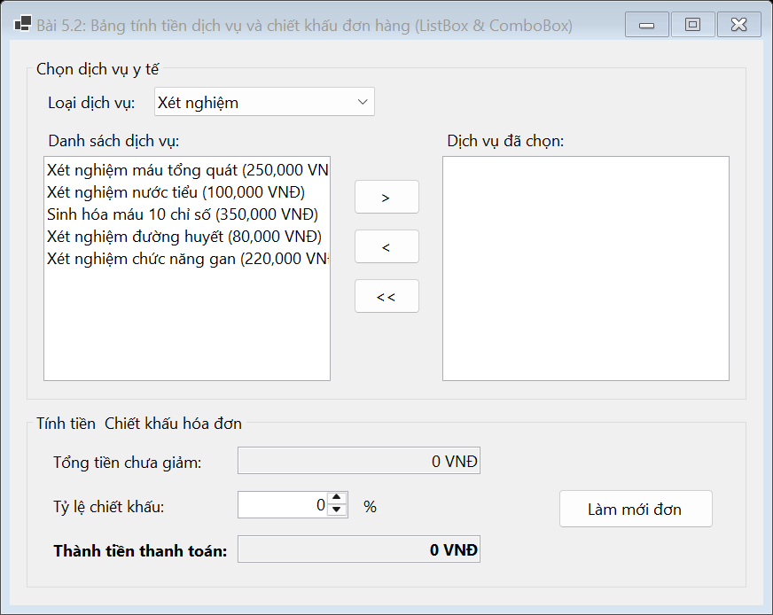
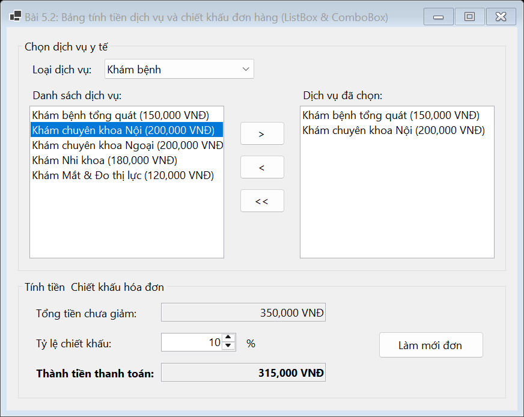
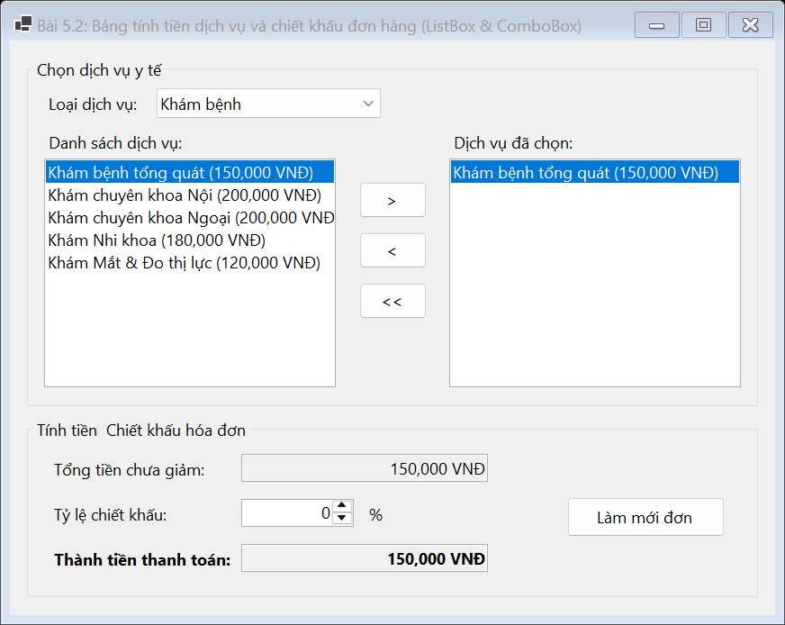

# BÁO CÁO BÀI TẬP / ĐỒ ÁN

## THÔNG TIN SINH VIÊN
- **Họ và tên:** Lê Thị Thúy Hiền
- **Mã số sinh viên:** 24810310243
- **Lớp:** D19CNPM3
- **Tên môn học:** Lập trình C# / Windows Forms
- **Tên bài tập:** BÀI 5.2: Bảng tính tiền dịch vụ và chiết khấu đơn hàng (ListBox & ComboBox)

---

## MÔ TẢ TÍNH NĂNG & YÊU CẦU ĐỀ BÀI
1. **Giao diện:**
   - ComboBox (`cboCategory`): Danh sách loại dịch vụ (*Khám bệnh*, *Xét nghiệm*, *Chụp X-Quang*, *Vắc-xin*).
   - ListBox (`lstAvailableServices`): Hiển thị danh sách dịch vụ thuộc loại được chọn.
   - ListBox (`lstSelectedServices`): Hiển thị danh sách dịch vụ người dùng đã chọn.
   - Các Button thao tác: `btnSelect` (`>`), `btnRemove` (`<`), `btnClearAll` (`<<`).
   - Nhóm tính tiền: **Tổng tiền chưa giảm**, **Tỷ lệ chiết khấu (%)**, **Thành tiền thanh toán**.
   - Giao diện chuẩn native Windows Forms, không màu mè.

2. **Yêu cầu chức năng:**
   - Khi thay đổi mục chọn trên ComboBox, load danh sách dịch vụ tương ứng vào `lstAvailableServices`.
   - Khi nhấn nút `>` hoặc Double Click vào một item ở `lstAvailableServices`, chuyển item đó sang `lstSelectedServices`.
   - Khi nhấn nút `<` hoặc Double Click vào một item ở `lstSelectedServices`, hủy bỏ dịch vụ khỏi danh sách chọn.
   - Nút `<<` xóa toàn bộ danh sách dịch vụ đã chọn.
   - **Tự động tính lại tổng chi phí** dựa trên đơn giá của các dịch vụ nằm trong `lstSelectedServices` mỗi khi có sự thay đổi danh sách hoặc thay đổi tỷ lệ chiết khấu.

---

## KẾT QUẢ KIỂM THỬ THEO YÊU CẦU ĐỀ BÀI

### 1. Giao diện chính ứng dụng

### 2. Kiểm thử: Thay đổi loại dịch vụ trên ComboBox
*(Chọn loại dịch vụ "Xét nghiệm", danh sách dịch vụ khả dụng lập tức nạp danh sách xét nghiệm tương ứng)*

### 3. Kiểm thử: Chọn dịch vụ sang danh sách đã chọn & Tự động tính tổng tiền
*(Bấm `>` hoặc Double-click chuyển dịch vụ sang ListBox đã chọn, hệ thống tự tính Tổng tiền chưa giảm)*

### 4. Kiểm thử: Áp dụng Tỷ lệ chiết khấu & Tính Thành tiền thanh toán
*(Nhập chiết khấu 10%, Thành tiền thanh toán tự động khấu trừ chính xác)*

### 5. Kiểm thử: Hủy chọn dịch vụ & Làm mới đơn
*(Thao tác nút `<` hoặc `<<` và nút Làm mới đưa bảng tính về trạng thái ban đầu)*

