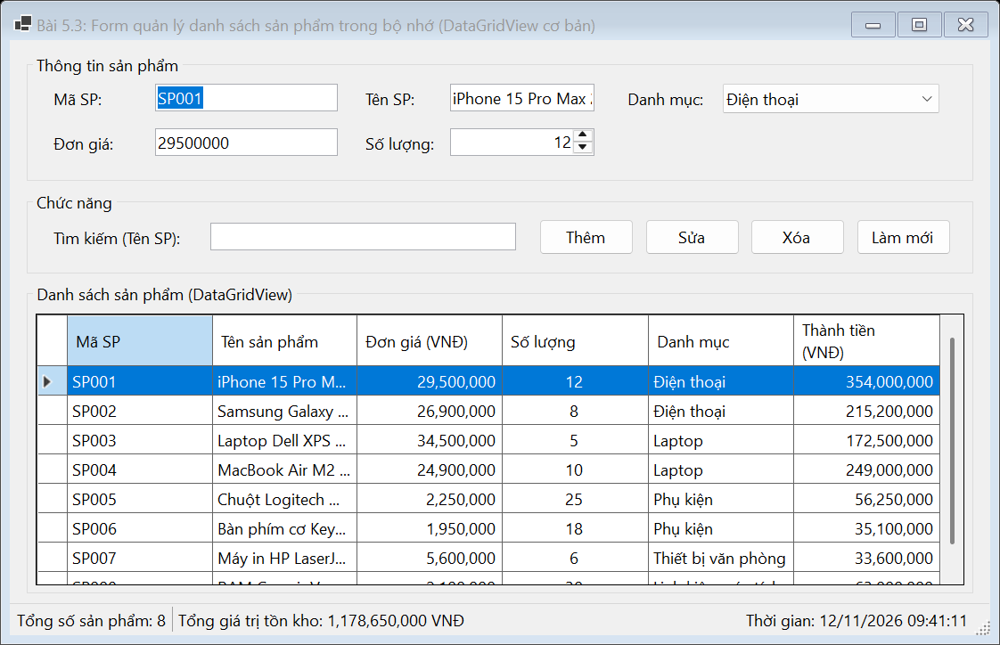
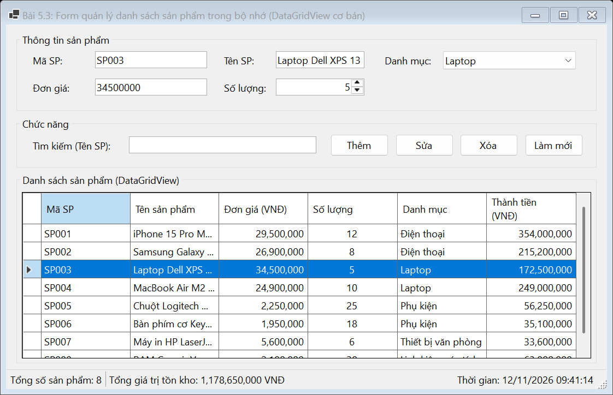
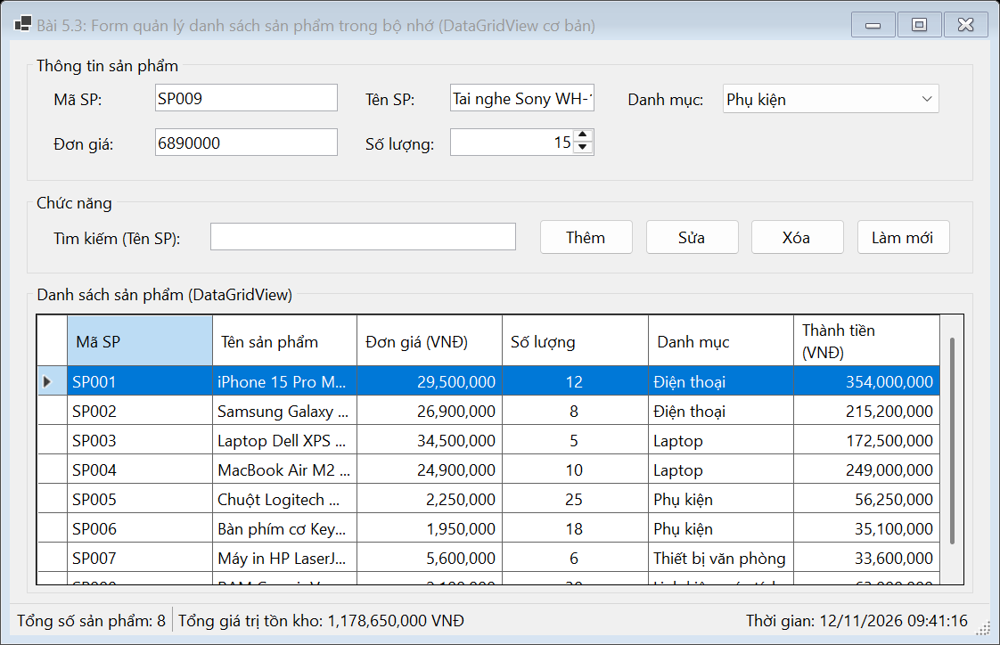
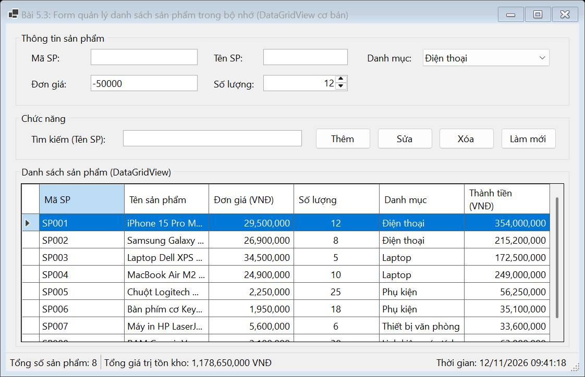
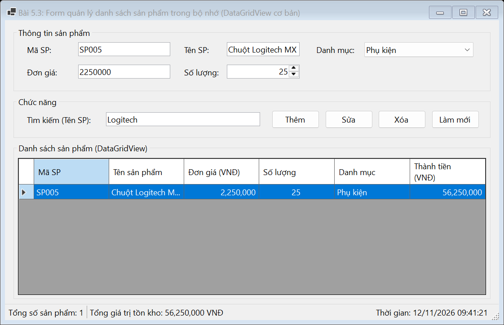

# BÁO CÁO BÀI TẬP / ĐỒ ÁN

## THÔNG TIN SINH VIÊN
- **Họ và tên:** Lê Thị Thúy Hiền
- **Mã số sinh viên:** 24810310243
- **Lớp:** D19CNPM3
- **Tên môn học:** Lập trình C# / Windows Forms
- **Tên bài tập:** BÀI 5.3: Form quản lý danh sách sản phẩm trong bộ nhớ (DataGridView cơ bản)

---

## MÔ TẢ TÍNH NĂNG & YÊU CẦU ĐỀ BÀI
1. **Khởi tạo Lớp Product:**
   - Lớp `Product` gồm các thuộc tính: `ProductId`, `ProductName`, `UnitPrice`, `Quantity`, `Category` và thuộc tính tính toán `TotalAmount` (Thành tiền = Đơn giá $\times$ Số lượng).
   - Sử dụng `BindingSource` và `BindingList<Product>` làm dữ liệu nguồn hiển thị trên `DataGridView`.

2. **Giao diện:**
   - GroupBox **Thông tin sản phẩm**: Mã SP, Tên SP, Đơn giá, Số lượng, Danh mục.
   - GroupBox **Chức năng**: Các nút **Thêm**, **Sửa**, **Xóa**, **Tìm kiếm** (theo Tên SP), **Làm mới**.
   - DataGridView (`dgvProducts`): Cột tự định nghĩa, định dạng số tiền tệ `N0`, căn phải cột tiền, căn giữa số lượng, `SelectionMode = FullRowSelect`.
   - `StatusStrip` hiển thị tổng số sản phẩm và tổng giá trị tồn kho; đồng hồ thời gian thực.
   - Giao diện chuẩn native Windows Forms, không màu mè.

3. **Yêu cầu chức năng:**
   - Nút **Thêm**: Khởi tạo đối tượng Product từ các ô nhập liệu, thêm vào danh sách và làm mới DataGridView.
   - **Đẩy ngược dữ liệu**: Khi Click vào một dòng trong DataGridView, đẩy ngược toàn bộ dữ liệu dòng đó lên các ô nhập liệu tương ứng để tiện xem/sửa đổi.
   - Nút **Sửa**: Cập nhật thông tin đối tượng đang chọn.
   - Nút **Xóa**: Xóa đối tượng đang được chọn sau khi người dùng xác nhận qua `MessageBox`.
   - **Tìm kiếm tức thời**: Lọc danh sách theo Tên sản phẩm.

---

## KẾT QUẢ KIỂM THỬ THEO YÊU CẦU ĐỀ BÀI

### 1. Giao diện chính ứng dụng

### 2. Kiểm thử: Đẩy ngược dữ liệu khi click dòng trên DataGridView
*(Click chọn một dòng sản phẩm, toàn bộ thông tin mã, tên, giá, số lượng, danh mục được nạp ngược lên các ô nhập liệu)*

### 3. Kiểm thử: Thêm sản phẩm mới thành công
*(Nhập thông tin sản phẩm mới, bấm Thêm $\rightarrow$ hiển thị thêm vào DataGridView và cập nhật StatusStrip)*

### 4. Kiểm thử Validation bằng ErrorProvider
*(ErrorProvider báo lỗi khi để trống mã/tên hoặc nhập đơn giá không hợp lệ)*

### 5. Kiểm thử Tìm kiếm tức thời theo Tên sản phẩm
*(Nhập từ khóa tìm kiếm, DataGridView lập tức hiển thị các sản phẩm phù hợp)*

