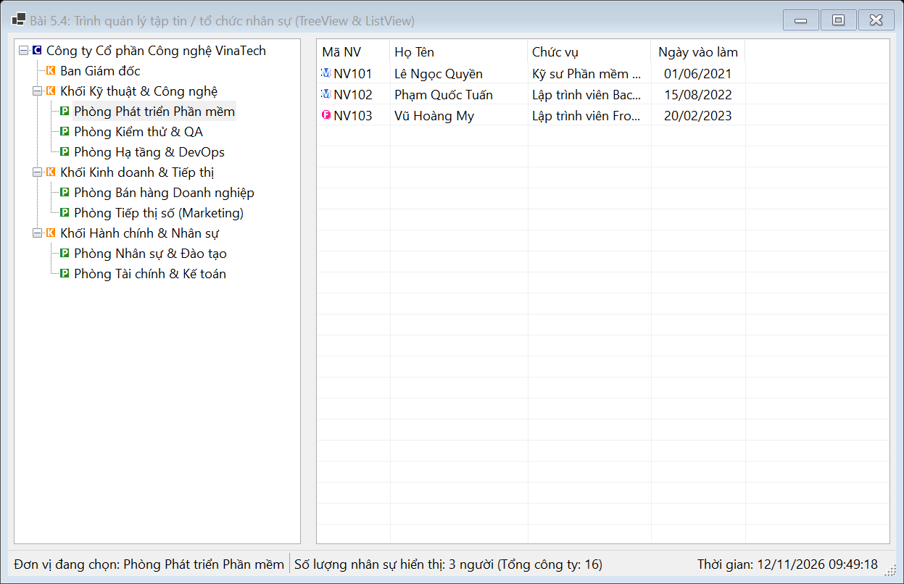
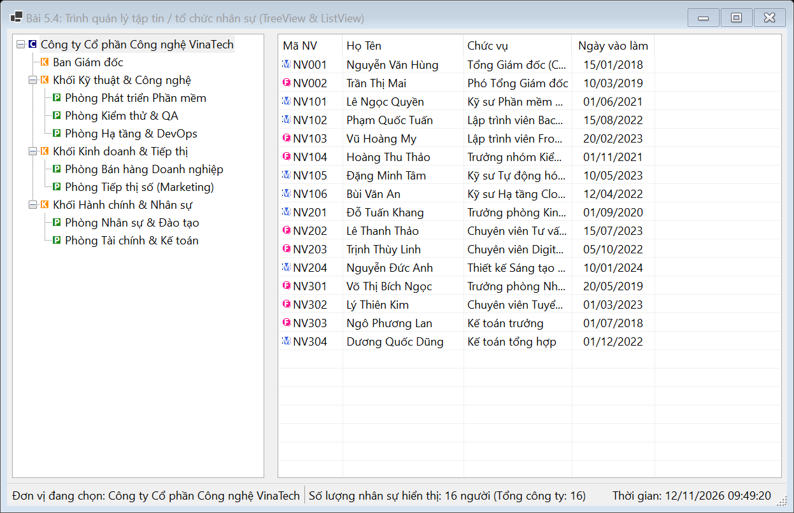
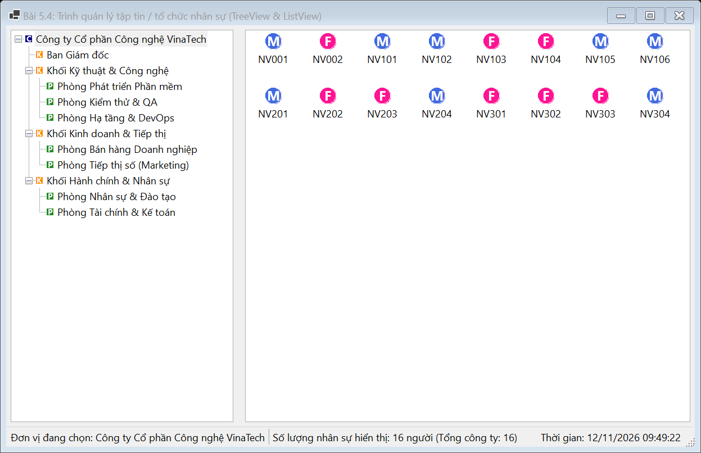
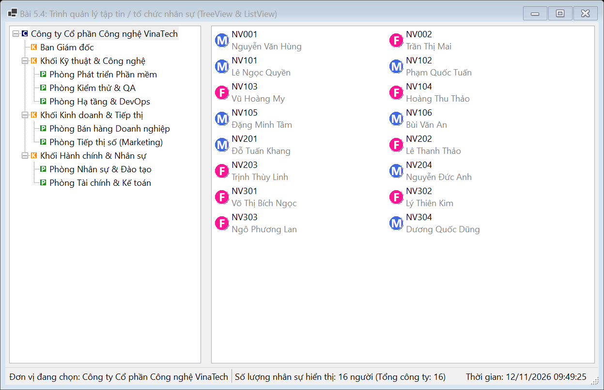

# BÁO CÁO BÀI TẬP / ĐỒ ÁN

## THÔNG TIN SINH VIÊN
- **Họ và tên:** Lê Thị Thúy Hiền
- **Mã số sinh viên:** 24810310243
- **Lớp:** D19CNPM3
- **Tên môn học:** Lập trình C# / Windows Forms
- **Tên bài tập:** BÀI 5.4: Trình quản lý tập tin / tổ chức nhân sự (TreeView & ListView)

---

## MÔ TẢ TÍNH NĂNG & YÊU CẦU ĐỀ BÀI
1. **Mục tiêu & Bố cục:**
   - Sử dụng kết hợp `TreeView` để phân cấp dữ liệu tổ chức (Công ty $\rightarrow$ Khối $\rightarrow$ Phòng ban) và `ListView` để hiển thị danh sách chi tiết ở nhiều chế độ xem (`Details`, `LargeIcon`, `SmallIcon`, `Tile`, `List`).
   - Sử dụng `SplitContainer`:
     * **Bên trái:** `TreeView (tvDepartments)` hiển thị cây phân cấp.
     * **Bên phải:** `ListView (lsvEmployees)` hiển thị danh sách nhân sự thuộc nhóm/phòng ban đang chọn.
   - `ImageList`: Chứa biểu tượng đại diện cho các Node trên TreeView và Icon đại diện cho nhân sự trên ListView (`SmallImageList` và `LargeImageList`).
   - `ComboBox (cboViewMode)`: Cho phép chuyển đổi chế độ xem của ListView.
   - Giao diện chuẩn native Windows Forms, không màu mè.

2. **Yêu cầu chức năng:**
   - Xây dựng cấu trúc cây dữ liệu mẫu cho TreeView khi khởi chạy ứng dụng.
   - Khi người dùng click chọn một Node trên TreeView, lọc danh sách nhân viên tương ứng thuộc Node đó (và các node con) rồi nạp vào ListView.
   - `ListView` ở chế độ **Details** hiển thị rõ ràng 4 cột: **Mã NV**, **Họ Tên**, **Chức vụ**, **Ngày vào làm**.
   - `StatusStrip` hiển thị phòng ban đang chọn, tổng số lượng nhân sự hiển thị và đồng hồ thời gian thực.

---

## KẾT QUẢ KIỂM THỬ THEO YÊU CẦU ĐỀ BÀI

### 1. Giao diện chính ứng dụng

### 2. Kiểm thử: Lọc danh sách nhân sự khi chọn Node phòng ban trên TreeView
*(Chọn "Phòng Phát triển Phần mềm", ListView lập tức lọc và hiển thị đúng danh sách nhân sự thuộc phòng này)*

### 3. Kiểm thử: Chế độ xem Details (Chi tiết 4 cột)
*(Hiển thị đầy đủ các cột: Mã NV, Họ Tên, Chức vụ, Ngày vào làm chuẩn định dạng)*

### 4. Kiểm thử: Chế độ xem LargeIcon (Biểu tượng lớn)
*(Chuyển ComboBox sang LargeIcon, danh sách nhân viên chuyển sang dạng lưới biểu tượng lớn)*

### 5. Kiểm thử: Chế độ xem Tile / SmallIcon
*(Chuyển sang chế độ xem dạng ô lát Tile)*

